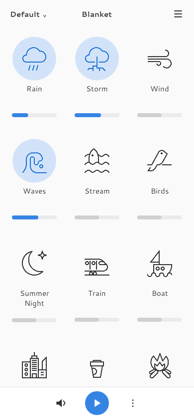
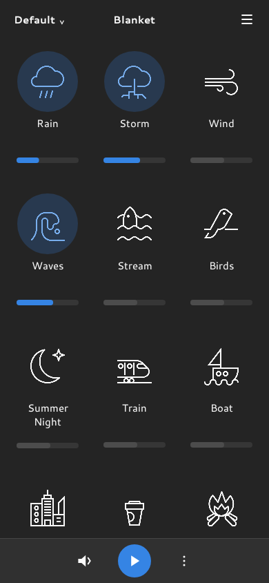

# Blanket for Android

Mix ambient sounds to create a background for focus, relaxation, or sleep.

Blanket for Android is an unofficial native port of [Blanket](https://github.com/rafaelmardojai/blanket) by Rafael Mardojai. It brings the original app's recordings, symbolic icons, and libadwaita-inspired interface to Android with Kotlin and Jetpack Compose.

<p>
  
  
</p>

Requires Android 8.0 or later.

## Features

- All 14 original sounds from Blanket 0.8.0, with continuous looping.
- Mix multiple sounds with individual volume controls and a main volume.
- Create, rename, delete, and switch presets. Changes save automatically.
- Add custom audio from device storage or a document provider.
- Background playback with notification and lockscreen controls.
- Switch presets with the media next and previous controls.
- Light, dark, and system themes.
- Optional start-paused and keep-awake settings, with automatic pause when battery saver turns on.

The built-in sounds are Birds, Boat, City, Coffee Shop, Fireplace, Pink Noise, Rain, Summer Night, Storm, Stream, Train, Waves, White Noise, and Wind.

## Use Blanket

Tap a sound icon to turn it on or off, then drag its slider to adjust the volume. Use the play button at the bottom to pause or resume the entire mix. The speaker button opens the main volume control.

Open the preset selector at the top to switch or manage presets. To save the current mix as a new preset, choose **Save as New Preset…** from the bottom menu. Edits save to the selected preset automatically. The **Default** preset always remains available.

Choose **Add Sound…** to select an audio file. Use a custom sound's menu to rename or remove it. Custom files remain in their original location, and removing a sound from Blanket leaves the source file intact.

Open **Preferences** from the main menu to change the theme, start playback paused, or keep the CPU awake during playback. Media next and previous controls move between presets without wrapping at the ends.

## Build from source

### Requirements

- JDK 17 or later.
- Android SDK Platform 37.0.
- Android SDK Build-Tools 36.0.0.
- Android SDK Platform-Tools for installation with ADB.

Clone the repository:

```sh
git clone https://github.com/mgamergo/blanket-android.git
cd blanket-android
```

Set `JAVA_HOME` to your JDK installation and `ANDROID_HOME` to your Android SDK installation. Alternatively, set `sdk.dir` in a local `local.properties` file. Keep that file out of version control.

Build a debug APK with the included Gradle wrapper:

```sh
./gradlew assembleDebug
```

The APK is available at `app/build/outputs/apk/debug/app-debug.apk`.

You can also open the repository in Android Studio, select a compatible Gradle JDK, and run the `app` configuration.

## Install

Connect an Android device with USB debugging enabled, then install the APK:

```sh
adb install -r app/build/outputs/apk/debug/app-debug.apk
```

For wireless installation on Android 11 or later, enable **Wireless debugging** in Developer options. Use the pairing and connection addresses shown on the device:

```sh
adb pair PHONE_IP:PAIRING_PORT
adb connect PHONE_IP:DEBUG_PORT
adb install -r app/build/outputs/apk/debug/app-debug.apk
```

You can also copy the APK to your device and open it with a file manager. Allow that file manager to install apps when Android prompts you.

## Development

The app uses Jetpack Compose for its interface, Media3 for playback and media controls, and DataStore for saved state. Dependency versions are defined in [`gradle/libs.versions.toml`](gradle/libs.versions.toml).

Run formatting checks, Android lint, and tests:

```sh
./gradlew :app:spotlessCheck lint test
```

The test suite includes state and persistence tests, playback service tests, Compose UI tests under Robolectric, and Roborazzi screenshot comparisons. Screenshot baselines are stored in [`docs/screenshots`](docs/screenshots).

After an intentional UI change, update the screenshot baselines:

```sh
./gradlew :app:testDebugUnitTest --tests '*BlanketUiTest*' -Proborazzi.test.record=true --rerun-tasks
```

Verify the bundled sounds and icons against their recorded upstream checksums:

```sh
scripts/verify-assets.sh app/build/outputs/apk/debug/app-debug.apk
```

See the [architecture notes](docs/architecture.md) for the state and playback design.

## Credits and license

Blanket for Android is based on [Blanket 0.8.0](https://github.com/rafaelmardojai/blanket/tree/0.8.0) by Rafael Mardojai CM. Sound icons are by Jakub Steiner, with sound editing by Porrumentzio.

The application is licensed under [GPL-3.0-or-later](LICENSE). Audio assets retain their original licenses. See [sound credits and licensing](SOUNDS_LICENSING.md) for every author and source. The bundled Cantarell fonts are by Dave Crossland and contributors, licensed under the [SIL Open Font License 1.1](app/src/main/assets/licenses/Cantarell-OFL.txt).

Credits and licenses are also available in the app's **About Blanket** screen.
